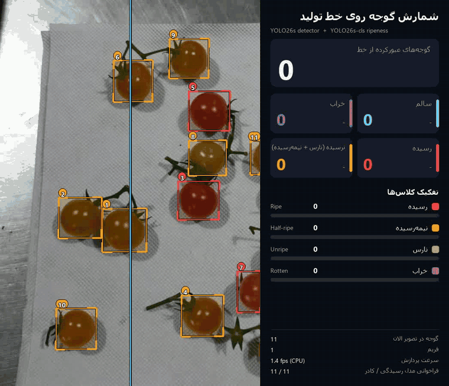
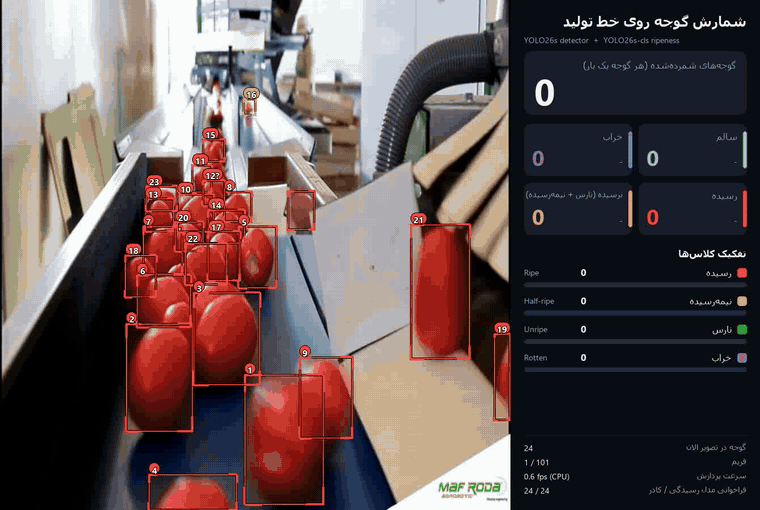
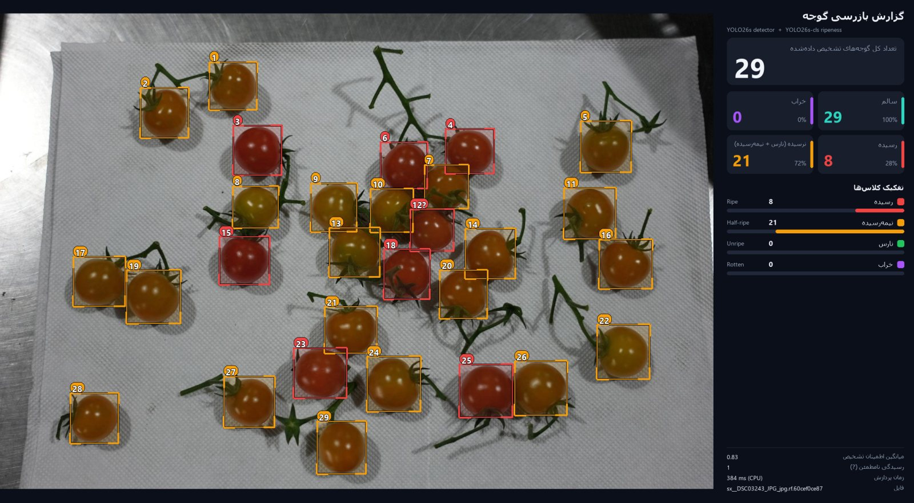
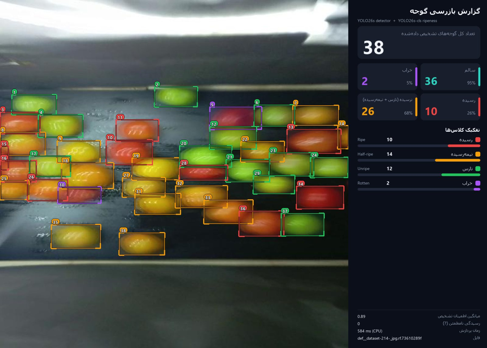
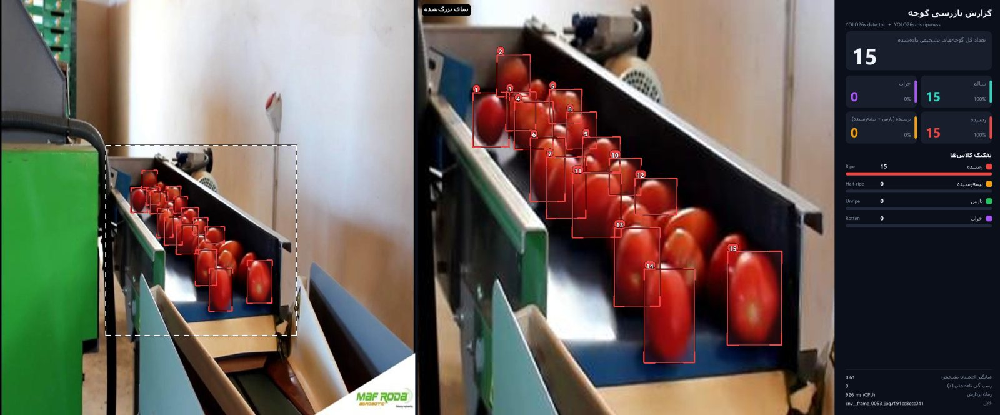
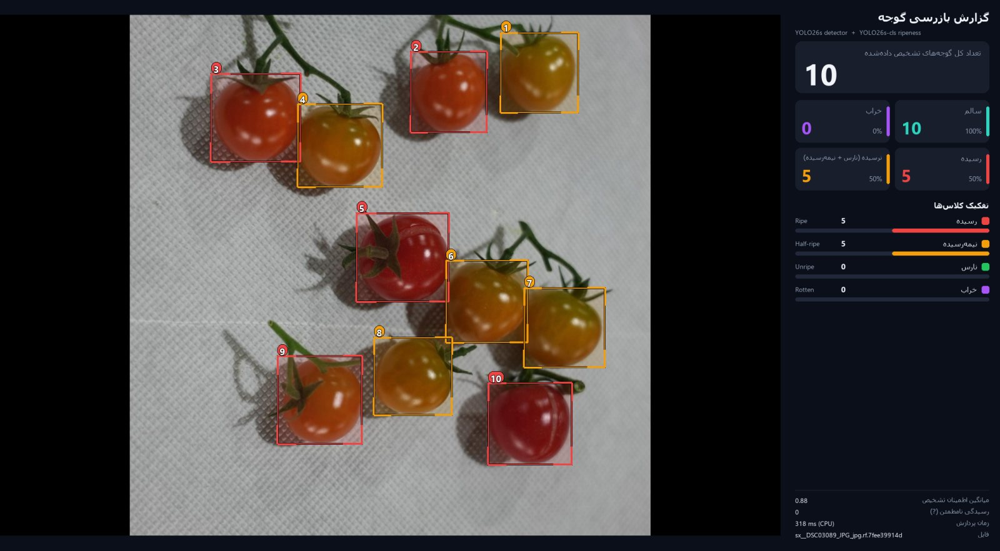
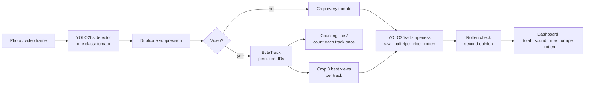
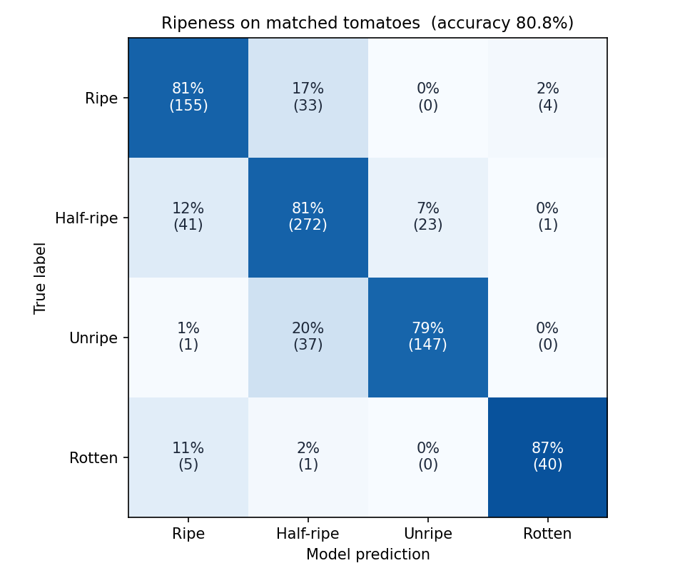

<div align="center">

# 🍅 Tomato Ripeness Detection, Counting & Tracking

**Real-time tomato detection, ripeness grading (unripe / half-ripe / ripe / rotten) and conveyor-belt counting with YOLO26 + ByteTrack**

[](#-quick-start)
[](https://github.com/ultralytics/ultralytics)
[](#-video--production-line-mode)
[](docs/DATASET.md)
[](LICENSE)
[](docs/DATASET.md#license--attribution)

[English](README.md) · [فارسی](README.fa.md)



*Every tomato gets a persistent ID, is counted **once** when it crosses the line and is graded by ripeness: live dashboard on the right.*

</div>

---

## ✨ What it does

| | |
|---|---|
| 🔍 **Detects every tomato** | YOLO26s detector, 99% recall on the Tomato Defects test set, 93% on unseen photos |
| 🎨 **Grades ripeness** | 4 classes — 🟢 unripe · 🟠 half-ripe · 🔴 ripe · 🟣 rotten — plus *sound vs rotten* at **98.6%** accuracy |
| 🔢 **Counts on a conveyor** | ByteTrack + counting line: each tomato counted **once**, **95–99%** counting accuracy in ground-truth tests |
| ⚡ **Cheap to run** | ripeness model runs only on a few good views per tomato → **70–88% less compute** than per-frame classification |
| 📊 **Readable output** | clean thin boxes, numbered tags, per-class colours, auto-zoom on clustered fruit and a dashboard with total / sound / ripe / unripe / rotten |
| 📷 **Photo, video, camera** | one command: `run.py photo.jpg`, `run.py belt.mp4`, `run.py 0` |

<div align="center">


*Real sorting-line footage: detection, tracking IDs and running count.*
</div>

## 📸 Results gallery

<table>
<tr>
<td></td>
<td></td>
</tr>
<tr>
<td align="center"><b>29 / 29 cherry tomatoes</b> — ripe vs half-ripe separated</td>
<td align="center"><b>Mixed batch</b> — all four ripeness classes</td>
</tr>
<tr>
<td></td>
<td></td>
</tr>
<tr>
<td align="center"><b>Conveyor</b> — automatic zoom when fruit fills only part of the frame</td>
<td align="center"><b>Ripe vs unripe</b> counted separately</td>
</tr>
</table>

## 🧠 How it works



**Two stages instead of one 4-class detector.** Detection only has to answer *"is this a tomato?"*, so it can learn from every tomato dataset (with or without ripeness labels). The ripeness classifier then looks at a 160×160 crop of each fruit. Both models are small (YOLO26s / YOLO26s-cls) and run on CPU.

**Rotten check.** The classifier learnt "rotten" from one dataset where rotten fruit is dark red; on a dark belt it called healthy deep-red tomatoes rotten. A light logistic-regression head on the classifier's own embedding, trained with conveyor tomatoes as *sound* examples, re-checks every "rotten" call: false rotten on the conveyor fell from **32 → 1**, while 97.5% of truly rotten tomatoes are still caught.

**Tracking for production.** On a line, the same tomato appears in dozens of frames; counting frames would over-count **16–53×**. Detections (down to conf 0.1, for ByteTrack's second association) are fed to ByteTrack with enlarged association boxes, so fast or small fruit keeps its ID.

## 📈 Benchmarks

All numbers are on images the models **never saw** in training (fixed holdouts; near-duplicates removed with perceptual hashing).

**Detection & counting (photos)**

| Test set | Images | Tomatoes | Recall | Precision | Per-image count accuracy |
|---|---:|---:|---:|---:|---:|
| Tomato Defects (test) | 86 | 768 | **99.0%** | 93.3% | 93.8% |
| Conveyor belt (holdout) | 43 | 650 | 84.9% | 90.0% | 89.7% |
| tomato-sxsc7 (holdout) | 57 | 736 | 93.3% | 94.8% | **96.3%** |

**Ripeness** (Tomato Defects test, matched tomatoes): 4-class **80.8%** · ripe / unripe / rotten **88.7%** · sound vs rotten **98.6%**. Almost all errors are between *neighbouring* stages (ripe ↔ half-ripe ↔ unripe); ripe is never confused with unripe.



**Video counting with tracking** (moving-camera clips built from labelled holdout photos, so the true count is known)

| Set | Belt speed | Counting accuracy | Without tracking | Ripeness compute saved |
|---|---|---:|---:|---:|
| tomato-sxsc7 | slow | **98.4%** | 42× over-count | 88% |
| tomato-sxsc7 | fast | **95.2%** | 16× over-count | 76% |
| Conveyor | slow | **99.3%** | 53× over-count | 87% |
| Conveyor | fast | 85.2% | 19× over-count | 70% |

Full details: [docs/RESULTS.md](docs/RESULTS.md).

## 🚀 Quick start

```bash
git clone https://github.com/ParsaVictor/tomato-ripeness-detection.git
cd tomato-ripeness-detection
pip install -r requirements.txt
# put the model files in weights/  (see "Model weights" below)
```

```bash
python tomato_app/run.py path/to/photo.jpg                 # one photo  -> results/run_photo/
python tomato_app/run.py path/to/folder/                   # every photo in a folder
python tomato_app/run.py belt.mp4 --line 0,0.6,1,0.6       # video, count at a horizontal line at 60% height
python tomato_app/run.py 0 --show                          # live camera
python tomato_app/run.py photo.jpg --tiles 2               # extra tiled pass for far, small tomatoes
```

Every run writes annotated images / an annotated video, `results.csv` / `tracks.csv` (one row per tomato) and a JSON summary.

## 📦 Model weights

The trained weights (detector, ripeness classifier and rotten check) are **available on request** — for research, pilots on your own line, or commercial use.

👉 **[Open an issue](https://github.com/ParsaVictor/tomato-ripeness-detection/issues/new?title=Model%20weights%20request)** or contact me through my [GitHub profile](https://github.com/ParsaVictor).

Expected files: `weights/detector_yolo26s_best.pt`, `weights/ripeness_yolo26s-cls_best.pt`, `weights/rotten_check.npz`.
Training is fully reproducible with [training/Tomato_Model_Colab.ipynb](training/Tomato_Model_Colab.ipynb) (free Colab T4 GPU).

## 🗂️ Dataset

**8,497 images · 74,486 tomato boxes**, unified from 6 public Roboflow Universe datasets into one consistent schema (`raw / half_ripe / ripe / rotten`, plus `tomato` where ripeness is unknown), with leakage-free holdouts and near-duplicate removal. See **[docs/DATASET.md](docs/DATASET.md)** for sources, splits, statistics and download.

## 🏭 Video / production-line mode

- **ByteTrack** with enlarged association boxes → small or fast tomatoes keep their ID
- **Counting line** (`--line x1,y1,x2,y2`) → a tomato is counted when its centre crosses the line; without a line, a track is counted after 3 frames
- **Ripeness voting** → up to 3 well-framed views per tomato, averaged; no per-frame flicker
- **Outputs** → annotated MP4, `tracks.csv` (ID, first/last frame, label, confidence), live dashboard

> For deployment, a fixed camera at 25–30 fps over the belt is ideal. Use `--every 2` to halve compute on slower hardware.

## 📁 Repository layout

```
tomato_app/
  run.py                 one entry point: photo / folder / video / camera
  tomato_inspect.py      two-stage inference + annotation + dashboard rendering
  tomato_video.py        tracking, line counting, per-track ripeness voting
  train_rotten_check.py  trains the rotten second-opinion head
  evaluate_local.py      photo benchmarks on the holdouts
  test_video_counting.py ground-truth video counting test
  make_report.py         HTML report (also a single-file version to share)
training/
  Tomato_Model_Colab.ipynb  end-to-end training on Google Colab (data download, holdouts, both models)
  phase5/                   data unification, leakage checks, class-agnostic evaluation
docs/                    results, dataset card
assets/                  GIFs and images used here
```

## 🗺️ Roadmap

- [ ] Fine-tune on footage from a real 25–30 fps sorting line
- [ ] Defect sub-types (cracks, sunscald, mould)
- [ ] Export to ONNX / OpenVINO / TensorRT for edge devices (Jetson, Raspberry Pi 5)
- [ ] Size / calibre estimation from a calibrated camera

## 💚 Support this project

If this saved you time, please **⭐ star the repo** — it really helps others find it.
Want it adapted to your line, crop or camera? [Get in touch](https://github.com/ParsaVictor/tomato-ripeness-detection/issues/new?title=Collaboration).

## 📜 License & citation

- **Code**: [AGPL-3.0](LICENSE) (it builds on Ultralytics YOLO, which is AGPL-3.0).
- **Data**: unified from CC BY 4.0 sources — see [attribution](docs/DATASET.md#license--attribution).

```bibtex
@software{tomato_ripeness_detection_2026,
  author = {Parsa Karkooti},
  title  = {Tomato Ripeness Detection, Counting and Tracking with YOLO26 and ByteTrack},
  year   = {2026},
  url    = {https://github.com/ParsaVictor/tomato-ripeness-detection}
}
```

<sub>Keywords: tomato detection, tomato ripeness classification, fruit counting, conveyor belt computer vision, agricultural AI, food quality inspection, YOLO26, YOLOv8, ByteTrack, object tracking, precision agriculture, smart farming, sorting machine, rotten fruit detection.</sub>
